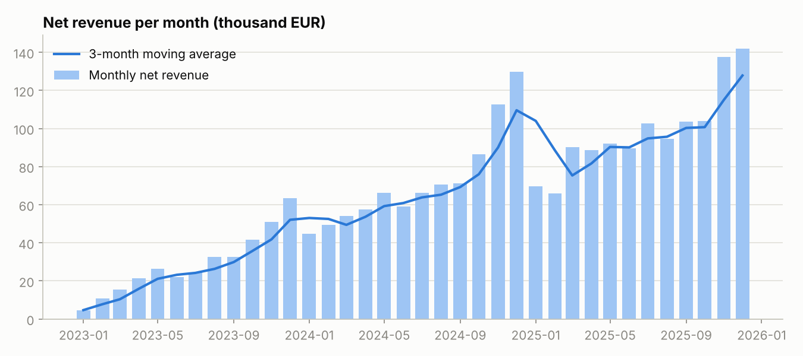
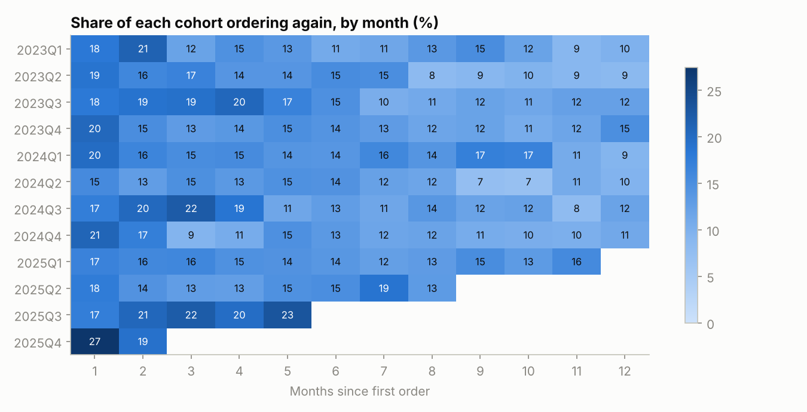
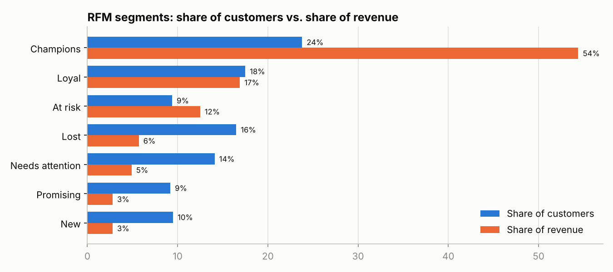

# Online Retail SQL Warehouse

[](https://github.com/mhmmdhaghjoo/online-retail-sql-warehouse/actions/workflows/ci.yml)

An end-to-end analytics warehouse for an online shop, written in PostgreSQL:
raw CSV exports are staged, profiled, cleaned into a star schema, tested, and
served through reporting views that answer concrete business questions.



## What it does

```
data/raw/*.csv ──▶ staging ──▶ data-quality report ──▶ star schema (dw) ──▶ marts ──▶ CSV + charts
   (3 files)       (as-is)       (12 checks)            (1 fact, 3 dims)   (views)
```

| Step | File | What happens |
|---|---|---|
| 1 | `sql/01_staging.sql` | Loads the three exports unchanged with `\copy` |
| 2 | `sql/02_quality_checks.sql` | Counts every rule violation before anything is cleaned |
| 3 | `sql/03_star_schema.sql` | Creates `fact_sales` and the date, customer and product dimensions with keys and `CHECK` constraints |
| 4 | `sql/04_load_star_schema.sql` | Cleans and loads; one documented rule per defect |
| 5 | `sql/05_marts.sql` | Reporting views: monthly KPIs, cohort retention, RFM segments, product ranking |
| 6 | `sql/06_tests.sql` | Eight assertions (row and revenue reconciliation, no gaps, no duplicates); a failure stops the build |
| 7 | `sql/07_performance.sql` | `EXPLAIN ANALYZE` of the same query without and with an index |
| 8 | `analysis/*.sql` | Seven business questions, each one query |

## The data

The data is **simulated**. `data/generate_data.py` creates three years of orders
(2023 to 2025) for 5,000 customers and 200 products with a fixed seed, including
seasonality, a late-November promotion, customers who stop buying, and products
that are often bought together. I chose a simulation because it can be published
and rebuilt by anyone, and because I could plant realistic defects and then check
that the warehouse finds every one of them. The findings below describe the
simulation, not a real company.

Defects found in the raw files (`output/data_quality_report.csv`):

| Table | Check | Rows | Rule applied in the load |
|---|---|---:|---|
| order_lines | exact duplicate rows | 374 of 37,797 | removed |
| order_lines | customer missing | 134 | assigned to an "unknown" customer so the revenue is kept |
| order_lines | quantity = 0 | 112 | excluded as cancelled |
| order_lines | quantity < 0 | 62 | treated as a sign error, absolute value used |
| customers | country not a clean ISO code | 178 | trimmed and upper-cased |
| customers | country missing | 99 | kept as NULL |
| customers | birth year 1900 | 42 | placeholder, set to NULL |
| products | category spelling variants | 16 of 200 | one spelling per category |

After cleaning, 37,313 order lines in 17,016 orders remain, worth EUR 2.40 million net.

## Findings

- **Growth.** Net revenue rose from EUR 0.35 M (2023) to EUR 0.87 M (2024) and
  EUR 1.18 M (2025). A linear trend fitted in SQL (`REGR_SLOPE`) gives about
  EUR 3,200 more per month, with R² = 0.86.
- **Retention.** 19 % of customers order again in the month after their first
  order, 14 % are active in month 6 and 11 % in month 12.

  

- **Customer value is concentrated.** The "Champions" RFM segment is 24 % of
  customers and 54 % of revenue. "At risk" customers (9 %) used to order often
  and account for 12 % of revenue, so they are the obvious win-back target.

  

- **Channels.** Email-acquired customers are worth the most (EUR 542 average
  revenue, 56.5 % repeat rate); the other four channels are close together
  (EUR 463 to 471).
- **Promotion.** From 20 to 30 November daily revenue is 34 % to 82 % above the
  rest of the year, depending on the year, at a margin 1 to 4 points lower.
- **Baskets.** The pair analysis recovers the product pairs that were planted in
  the simulation, with lift values above 50.
- **Indexing.** On a 1.5 million row copy of the fact table, a one-week filter
  changes from a parallel sequential scan to a bitmap index scan once
  `date_key` is indexed (`output/query_plans.txt`).

## SQL techniques used

Window functions (`LAG`, `NTILE`, `RANK`, `FIRST_VALUE`, moving and running
frames, named `WINDOW`), common table expressions, `ROLLUP` with `GROUPING`,
`FILTER`, ordered-set aggregates (`PERCENTILE_CONT`), regression aggregates,
self-joins, `GENERATE_SERIES`, identity columns, primary and foreign keys,
`CHECK` constraints, views, B-tree indexes with `EXPLAIN ANALYZE`, PL/pgSQL
assertions, and `\copy` for import and export.

## Run it

Requirements: PostgreSQL 14 or later with `psql`, Python 3.10 or later.

```bash
pip install -r requirements.txt
docker compose up -d                 # or use any PostgreSQL you already have
export PGHOST=localhost PGUSER=postgres PGPASSWORD=postgres PGDATABASE=retail
./run.sh                             # generates data, builds, tests, exports
pytest                               # tests for the data generator
```

`run.sh` rebuilds everything from scratch each time. Results land in `output/`.
The numbers above come from seed 42; a different NumPy version can shift them
slightly.

## Layout

```
data/generate_data.py   simulator for the raw exports
sql/                    staging, checks, schema, load, marts, tests, performance
analysis/               one business question per file
report/make_charts.py   charts from the exported CSVs
output/                 exported results and charts
tests/                  pytest tests for the simulator
```

## Licence

MIT
